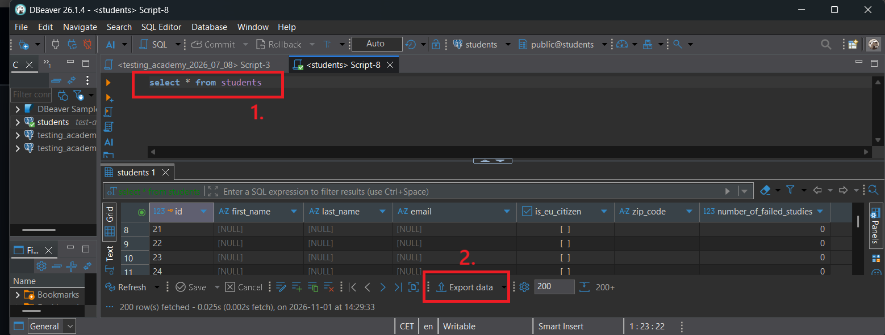
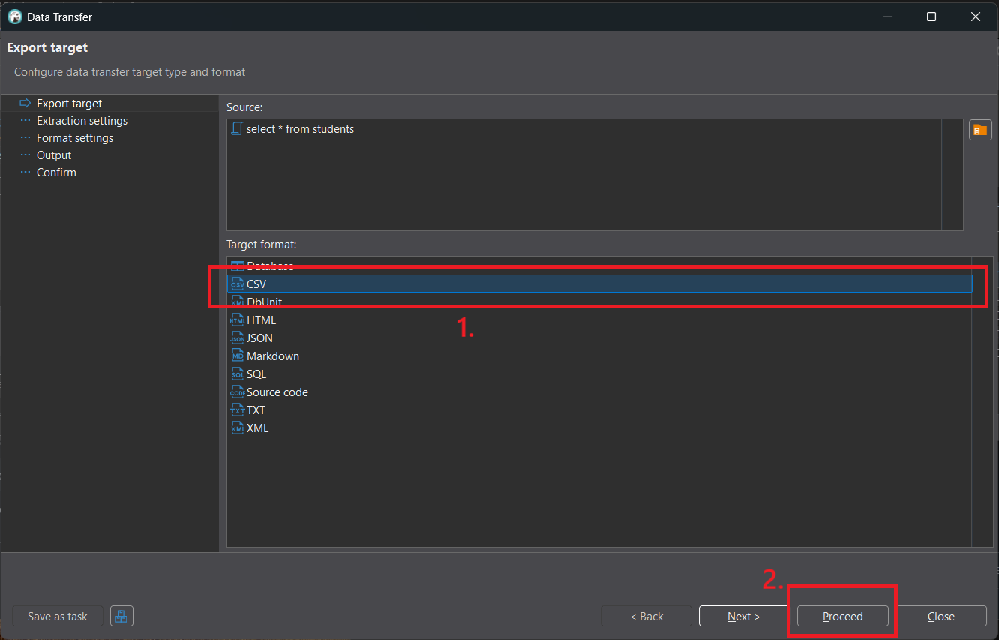
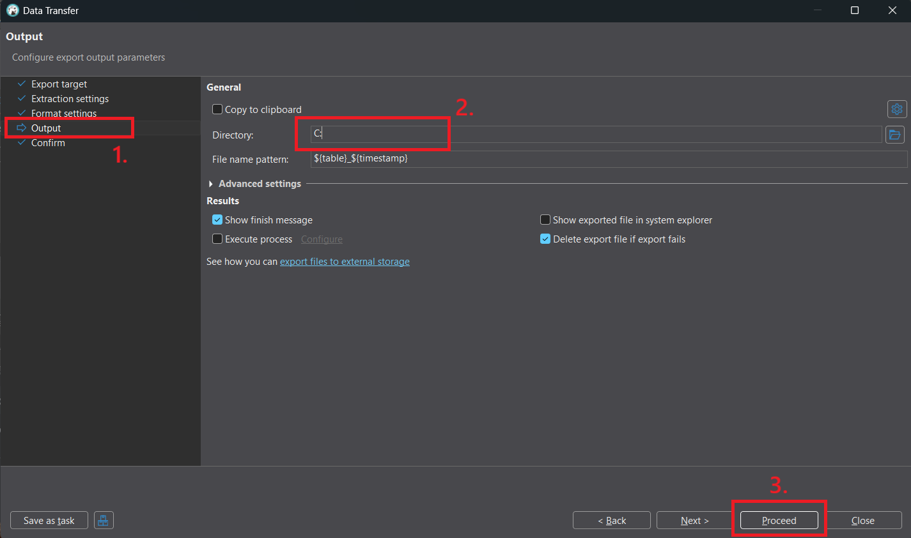

## Export tabulky DBever

Tabulku jsme exportovali následujícími kroky:
1. Po vrácení dat z SQL dotazu klikneme na Export Data
  
 

2. Na následujícím dialogu vybereme typ výstupu jako csv
  
 

3. Přepneme se na list Output. Zde zadáme adresu kam chceme daný soubor uložit. Následně ukončíme export pomocí tlačítka Proceed

