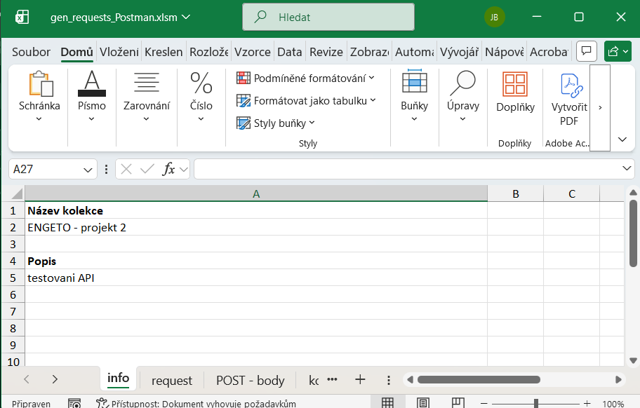
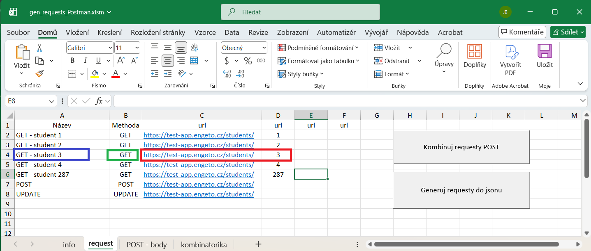
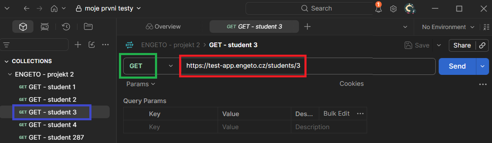
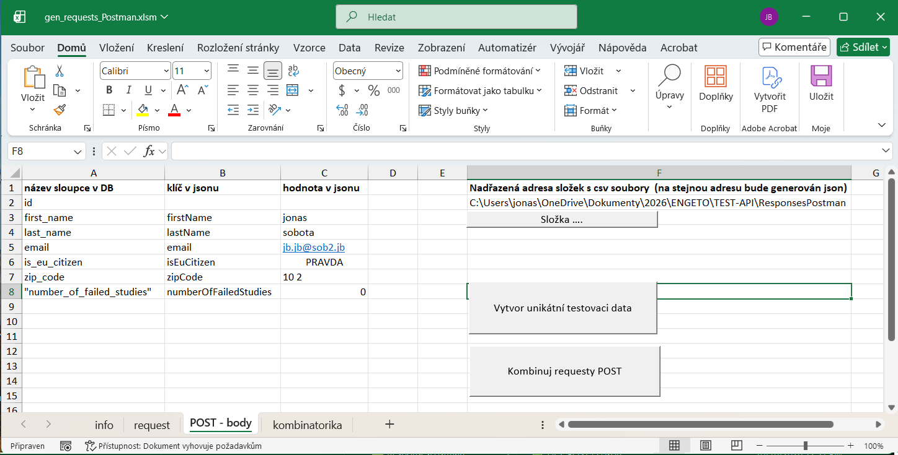
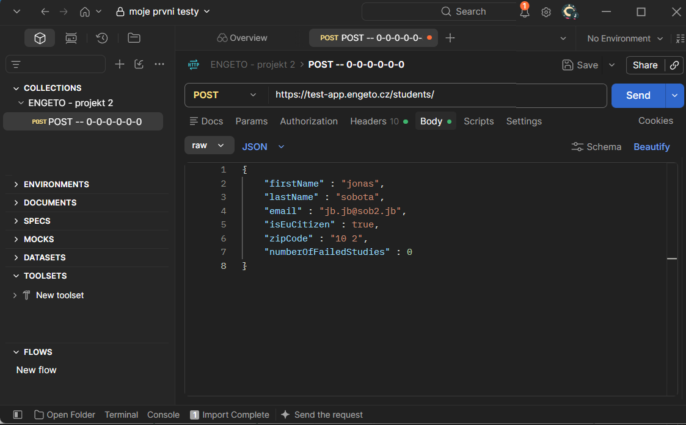

## Generování requestů GET + POST
Stáhneme soubor
[zde](https://github.com/jonasRower/Testing-Engeto-Project-2/blob/main/Tools/Gen%20Request/gen_requests_Postman.xlsm)  
Je potřeba odblokovat makra:
[Jak odblokovat makra](https://github.com/jonasRower/Testing-Engeto-Project-2/blob/main/odblok_Makro_VBA.md)  
Otevřeme stažený soubor. 
 

list "info"

 
 
Vyplníme hodnoty do buněk A2 a A5

list "request"

List request vyplníme podle vzoru viz obrázek níže:
  
  
kde jsme barevně zarámovali vstupní hodnoty. Stejnou barvou jsou zarámované hodnoty v Postmanu

list "POST - body"

### Vyplnění sloupců A , B , C
Vyplníme list POST - body dle vzoru níže:

Kde sloupce B a C odpovídají tělu requestu v Postmanu. Sloupec A odpovídá atributům z DB.
  
 

### Vytvoření sady jedinečných hodnot
Pro testování je však zapotřebí vytvořit jedinečnou sadu hodnot.  

Nastavení složky s daty z DB

