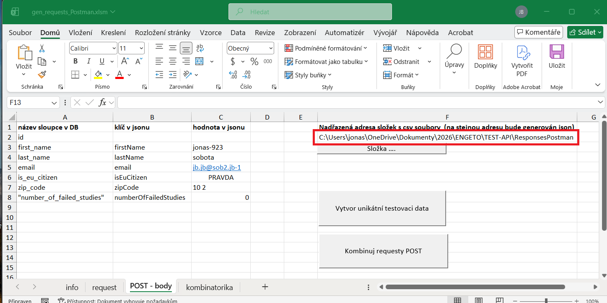
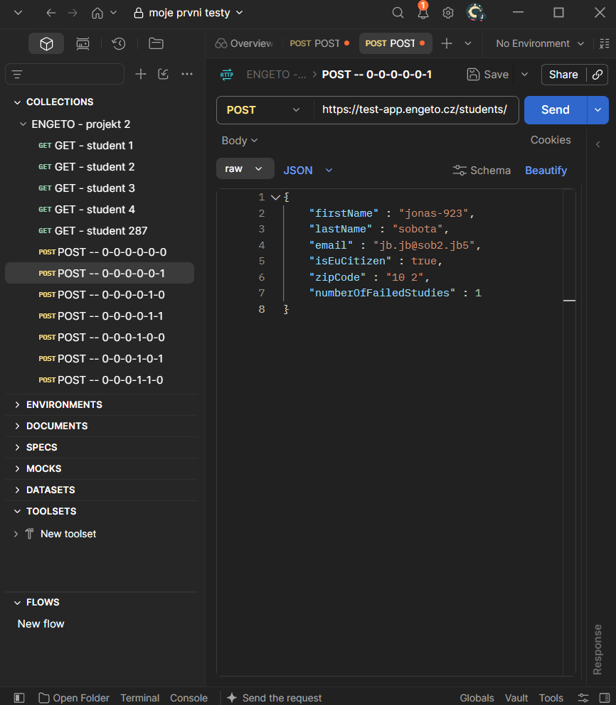
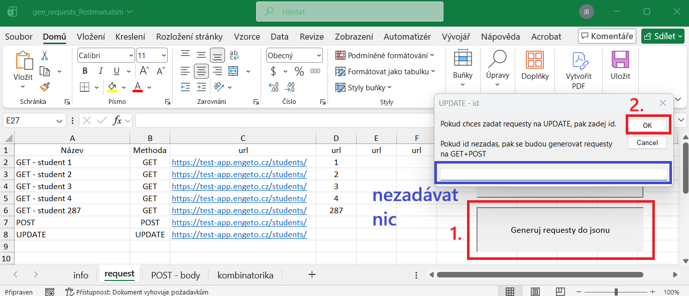
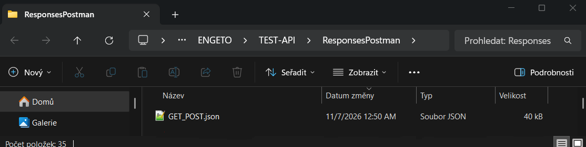

## Generování requestů GET + POST
Stáhneme soubor
[zde](https://github.com/jonasRower/Testing-Engeto-Project-2/blob/main/Tools/Gen%20Request/gen_requests_Postman.xlsm)  
Je potřeba odblokovat makra:
[Jak odblokovat makra](https://github.com/jonasRower/Testing-Engeto-Project-2/blob/main/odblok_Makro_VBA.md)  
Otevřeme stažený soubor. 
 
### Vyplnění vstupních hodnot

list "info"

 
 
Vyplníme hodnoty do buněk A2 a A5

list "request"

List request vyplníme podle vzoru viz obrázek níže:
  
  
kde jsme barevně zarámovali vstupní hodnoty. Stejnou barvou jsou zarámované hodnoty v Postmanu

list "POST - body"

 
 
### Vyplnění sloupců A , B , C
Vyplníme list POST - body dle vzoru níže:

Kde sloupce B a C odpovídají tělu requestu v Postmanu. Sloupec A odpovídá atributům z DB.
  

  
### Vytvoření sady jedinečných hodnot
Pro testování je však zapotřebí vytvořit jedinečnou sadu hodnot. Je potřeba tedy ověřit, že data ve sloupci C nejsou duplicitní k datům exportovaným z DB. 

Nastavení složky s daty z DB

 
Postup exportování dat z DB popisujeme
 
[zde](https://github.com/jonasRower/Testing-Engeto-Project-2/blob/main/export_DB.md)  

Poté je potřeba nastavit složku s cestou s exportovanými csv soubory. Lze zadat jakoukoliv nadřazenou složku. Program vyhledá všechny csv soubory, které jsou názvu [název tabulky]_datum čas.csv.  
Adresu nadřazené složky můžeme překopírovat pomocí Ctrl+C a Ctrl+V z průzkumníku složek, nebo složku vybrat pomocí tlačítka
   

Jedná se o adresu složky umístěné v buňce F2

 

Ověření duplicitnícxh dat

 
Po stisku tlačítka "Vytvor unikatni testovaci data" se záznamy všech těchto tabulek, uloženými na adrese výše, porovnají s hodnotami ve sloupci C.
Nalezne-li program shodná data ve sloupci C s daty vyexportovanými z DB, pak se zeptá uživatele, zda hodnotu smí přečíslovat. Po stisku na tlačítko "Ano" se hodnota přečísluje.
 

 
Potvrdili jsme "Ano" a duplicitní hodnoty se přečíslovali, viz obr níže, sloupec C.

  
### Kombinatorika jedinečných hodnot
Stisknutím tlačítka "Kombinuj requesty POST" se vytvoří kombinace jednotlivých requestů metody POST. Všechny vytvořené kombinace jsou vygenerovány na list "kombinatorika"
  

Po vygenerování a nahrání jsonu do Postmanu, může request metody POST vypadat následovně:

Logika generovaných kombinací.

 
Jednotlivé řádky na listu "kombinatorika" představují jednotlivé kombinace vstupů. Lze si povšimnout prvního řádku:  

Nazev kombinace  | firstName   | lastName   |  email          |  isEuCitizen |  zipCode  |  numberOfFailedStudies
-------------    | ----------- | --------   |  -----          |  ----------- |  -------  |  ---------------------
0-0-0-0-0-0	     | jonas-923   | sobota   |  jb.jb@sob2.jb-1          |  PRAVDA |  10 2  |  0

Zde se tedy jedná o generovaná unikátní data.      

Druhý řádek pak vypadá následovně:  
Nazev kombinace  | firstName   | lastName   |  email          |  isEuCitizen |  zipCode  |  numberOfFailedStudies
-------------    | ----------- | --------   |  -----          |  ----------- |  -------  |  ---------------------
0-0-0-0-0-1	     | jonas-923   | sobota   |  jb.jb@sob2.jb-1          |  PRAVDA |  10 2  |  1

Změnila se nám hodnota pouze u atributu "numberOfFailedStudies" z 0 na 1. Kombinace na daném řádku je totiž:  
0-0-0-0-0-1	  

kde hodnota (v kombinaci) = 0 symbolizuje, že hodnota je hodnotou původní,  
zatímco hodnota = 1 symbolizuje, že se jedná o hodnotu unikátní, tzn. v žádné předchozí kombinaci se nevyskytuje.   

Podíváme-li se např. na řádek 34 pak hodnoty jsou následující:  
Nazev kombinace  | firstName   | lastName   |  email          |  isEuCitizen |  zipCode  |  numberOfFailedStudies
-------------    | ----------- | --------   |  -----          |  ----------- |  -------  |  ---------------------
1-0-0-0-0-0	     | jonas-923_1   | sobota   |  jb.jb@sob2.jb-1          |  PRAVDA |  10 2  |  0

zde se změnila pouze hodnota u atributu firstName, ostatní zůstaly stejné. Hodnota u atributu firstName je jonas-923_1.   

Řádek 35 pak ukazuje:  
Nazev kombinace  | firstName   | lastName   |  email          |  isEuCitizen |  zipCode  |  numberOfFailedStudies
-------------    | ----------- | --------   |  -----          |  ----------- |  -------  |  ---------------------
1-0-0-0-0-1	     | jonas-923_2   | sobota   |  jb.jb@sob2.jb-1          |  PRAVDA |  10 2  |  17

Zde, ačkoliv hodnota v kombinaci u atributu firstName je symbolizována hodnotou 1 (1-0-0-0-0-1), tudíž hodnota u atributu firstName by měla být unikátní též, v žádném vyšším řádku neužita, proto na rozdíl od řádku 34 uvažuje hodnotu jonas-923_2.   

Algoritmus generování kombinací.
  
Generujeme jednotlivé requesty tak, aby hodnota v těle requestu byla buď unikátní, nebo již opakující se. Opakující se hodnota je symbolizována hodnotou 0, unikátní hodnota je symbolizována hodnotou 1.   
Jednotlivé hodnoty v Názvu kombinace (1 nebo 0) jsou, pro lepší přehlednost odděleny pomlčkami (-).  
Defacto bez pomlček se jedná o následující čísla typu Integer:  

Nazev kombinace (String)  | Číslo v binární soustavě   | Číslo v dekadické soustavě         
-------------    | ----------- | --------          
1-0-0-0-0-0	     | 0           | 0           

  

 
Nazev kombinace (String) | Číslo ve dvojkové soustavě | Číslo v dekadické soustavě
-------------            | -----------                | --------   
0-0-0-0-0-0	             | 0                          | 1   

 

### Vygenerování jsonu do Postmanu
Stiskem tlačítka "Generuj requesty do jsonu" vygenerujeme json.

Umístění generovaného souboru v počítači nalezneme na adrese, kterou jsme zadali na list "request" do buňky F2

Soubor jsme vygenerovali s názvem GET_POST.json

