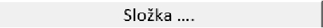
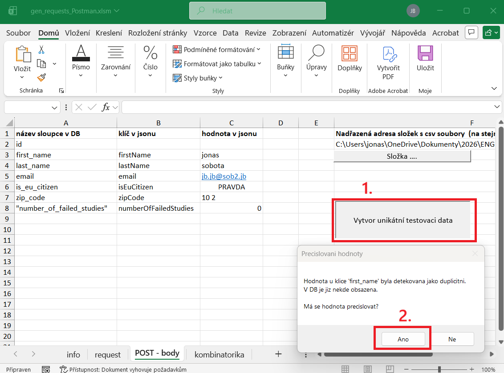
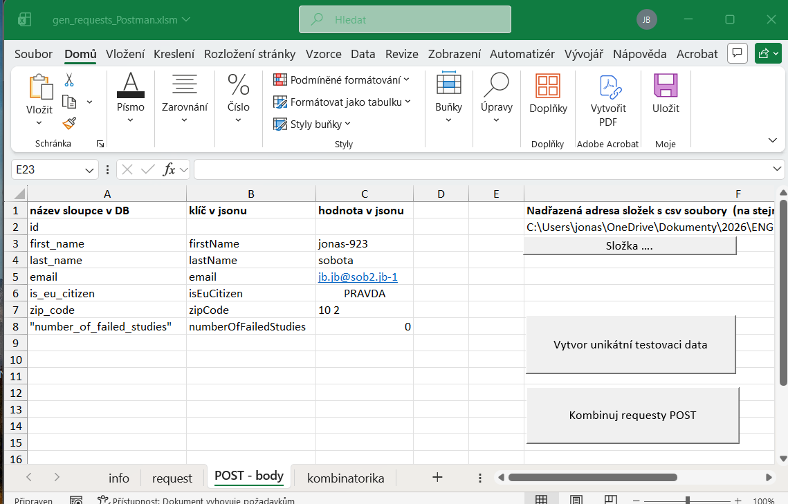
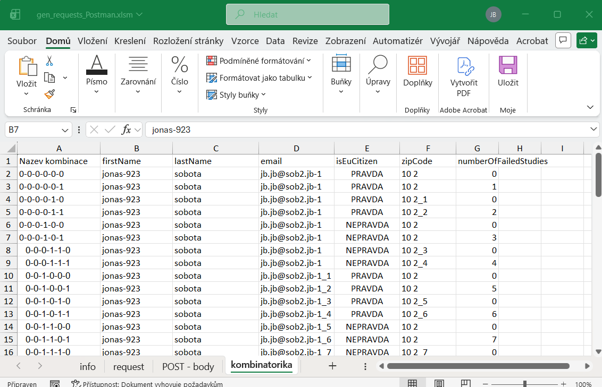

## Generování requestů GET + POST
Stáhneme soubor
[zde](https://github.com/jonasRower/Testing-Engeto-Project-2/blob/main/Tools/Gen%20Request/gen_requests_Postman.xlsm)  
Je potřeba odblokovat makra:
[Jak odblokovat makra](https://github.com/jonasRower/Testing-Engeto-Project-2/blob/main/odblok_Makro_VBA.md)  
Otevřeme stažený soubor. 
 

list "info"

 
 
Vyplníme hodnoty do buněk A2 a A5

list "request"

List request vyplníme podle vzoru viz obrázek níže:
  
  
kde jsme barevně zarámovali vstupní hodnoty. Stejnou barvou jsou zarámované hodnoty v Postmanu

list "POST - body"

### Vyplnění sloupců A , B , C
Vyplníme list POST - body dle vzoru níže:

Kde sloupce B a C odpovídají tělu requestu v Postmanu. Sloupec A odpovídá atributům z DB.
  
 

### Vytvoření sady jedinečných hodnot
Pro testování je však zapotřebí vytvořit jedinečnou sadu hodnot. Je potřeba tedy ověřit, že data ve sloupci C nejsou duplicitní k datům exportovaným z DB. 

Nastavení složky s daty z DB

 
Postup exportování dat z DB popisujeme
[zde](https://github.com/jonasRower/Testing-Engeto-Project-2/blob/main/export_DB.md)  

Poté je potřeba nastavit složku s cestou s exportovanými csv soubory. Lze zadat jakoukoliv nadřazenou složku. Program vyhledá všechny csv soubory, které jsou názvu [název tabulky]_datum čas.csv.  
Adresu nadřazené složky můžeme překopírovat pomocí Ctrl+C a Ctrl+V z průzkumníku složek, nebo složku vybrat pomocí tlačítka
 
 

Ověření duplicitnícxh dat

 
Po stisku tlačítka "Vytvor unikatni testovaci data" se záznamy všech těchto tabulek, uloženými na adrese výše, porovnají s hodnotami ve sloupci C.
Nalezne-li program shodná data ve sloupci C s daty vyexportovanými z DB, pak se zeptá uživatele, zda hodnotu smí přečíslovat. Po stisku na tlačítko "Ano" se hodnota přečísluje.
 

 
Potvrdili jsme "Ano" a duplicitní hodnoty se přečíslovali, viz obr níže, sloupec C.

### Kombinatorika jedinečných hodnot
Stisknutím tlačítka "Kombinuj requesty POST" se vytvoří kombinace jednotlivých requestů metody POST. Všechny vytvořené kombinace jsou vygenerovány na list "kombinatorika"

