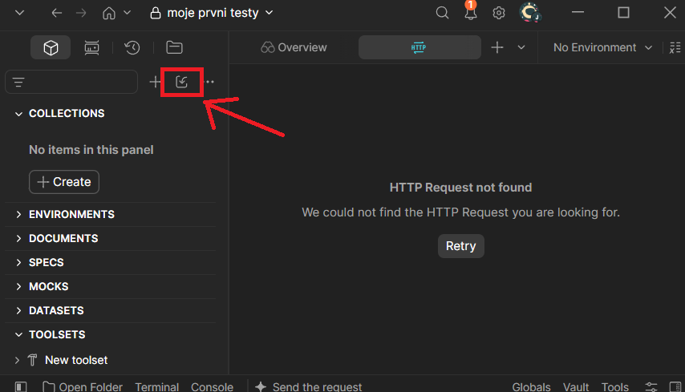
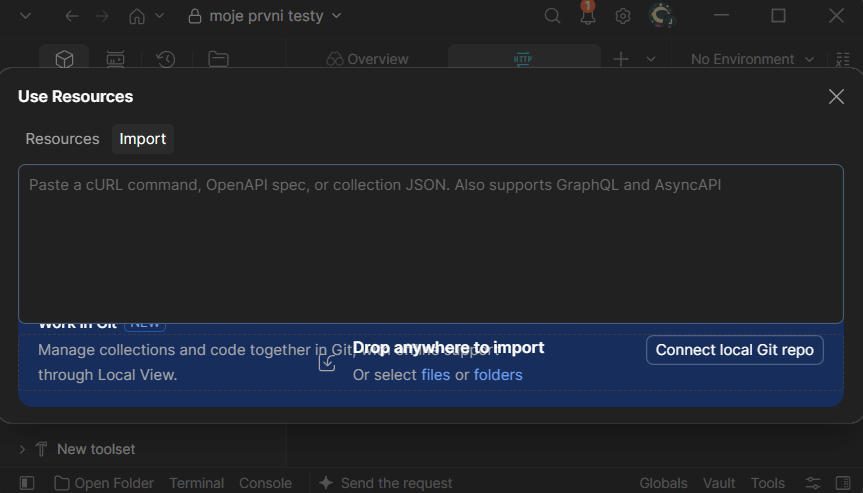
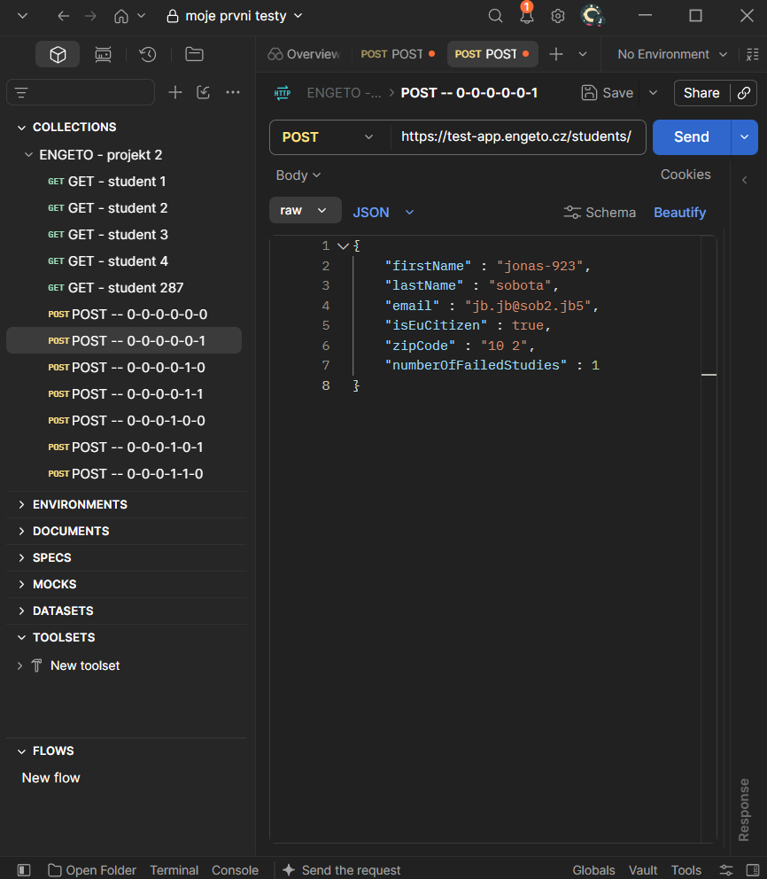

## Importování requestů do Postmanu

Máme připravený soubor zde:  
[GET_POST.json](https://github.com/jonasRower/Testing-Engeto-Project-2/blob/main/Requests%20Postman/GET_POST.json)
  

Daný soubor importujeme do Postmanu pomocí kliknutí na ikonu, viz. obr. níže.  

Následně přesuneme soubor z lokálního umístění na disku

Výsledek by měl vypadat následovně:

