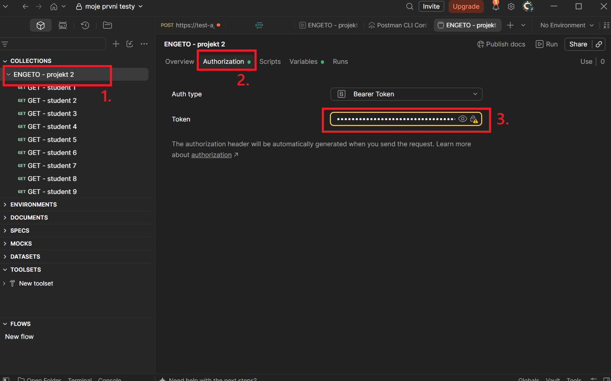

## Spuštění testů hromadně v Postmanu

Requesty importujeme dle manuálu
[import requestů](https://github.com/jonasRower/Testing-Engeto-Project-2/blob/main/import_Json_Postman.md)

Autorizaci zadáme do vstupního pole pro danou Kolekci. Tím se autorizují všechny testy jedním vstupem.

