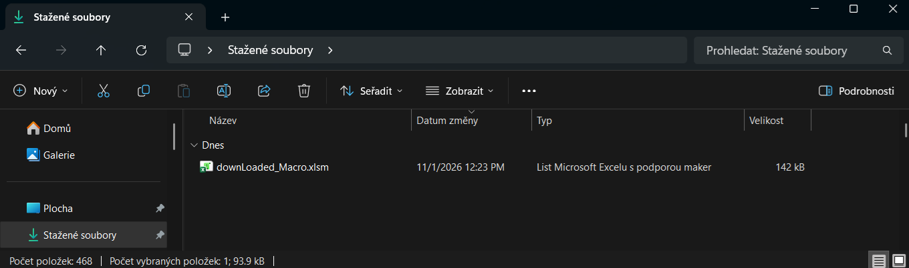
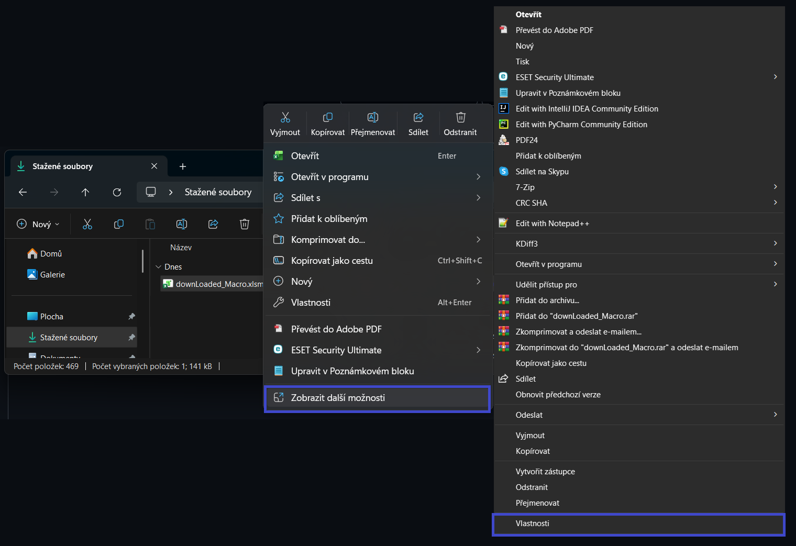
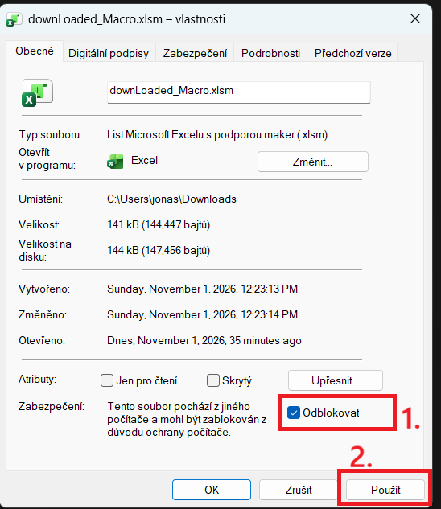

## Odblokování maker v souborech MS Excelu

Soubor MS Excelu obsahující makra je označen příponou xlsm. 
Pokud je soubor Excelu obsahující Makra, stažen z internetového prostředí, MS Windows automaticky blokuje makra.

Pro stažení a odblokování maker provedeme následující kroky:
1. Stáhnout soubor do PC

2. Vyvolat nabídku Vlastnosti souboru.   To provedeme levým klikem na soubor ->  Zobrazit další možnosti -> Vlastnosti
   

3. V nabídce Vlastnosti na kartě Obecné, zaškrtneme Checkbox Odblokovat a následně stiskneme Použít
   
