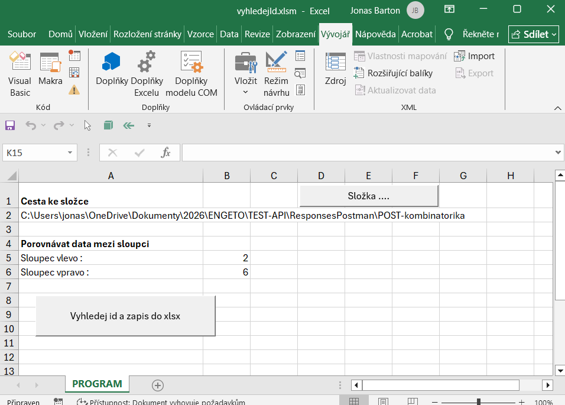
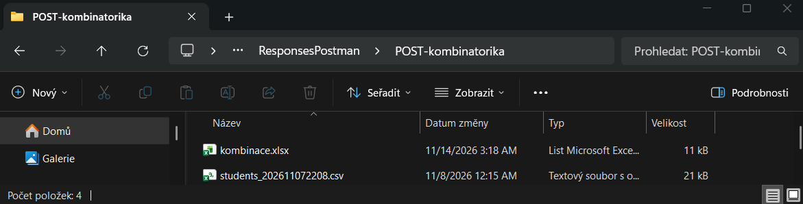
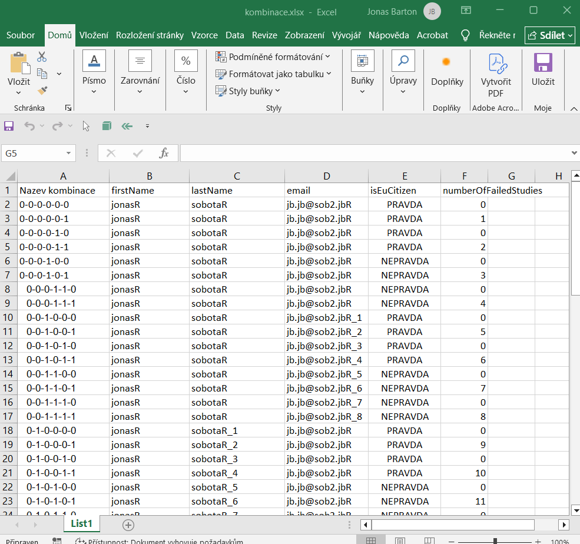
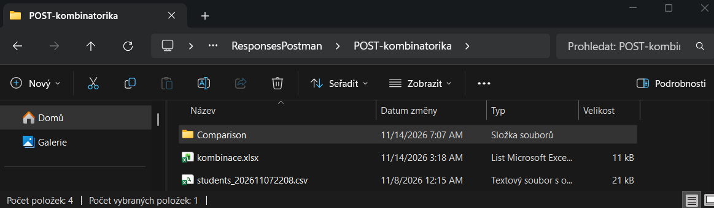
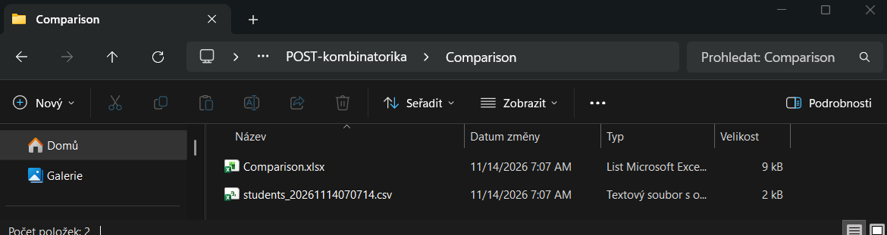

## Vyhodnocení proběhlých testů kombinatoriky.

Nástroj pro vyhodnocení proběhlých testů stáhneme [zde](https://github.com/jonasRower/Testing-Engeto-Project-2/blob/main/Tools/vyhledejId/vyhledejId.xlsm)

Je potřeba odblokovat makra:
[Jak odblokovat makra](https://github.com/jonasRower/Testing-Engeto-Project-2/blob/main/odblok_Makro_VBA.md)  

Nástroj obsahuje jediný list s názvem "PROGRAM"

 
Do buňky A2 vyplníme cestu ke složce s daty, příp. můžeme výběr provést pomocí tlačítka "Složka ..."  

Daná složka obsahuje soubor xlsx a tabulku csv. 
Tabulku csv získáme exportem dat z DB, jak je popsáno: [export z DB](https://github.com/jonasRower/Testing-Engeto-Project-2/blob/main/export_DB.md)

Soubor kombinace.xlsx obsahuje data:

soubor jsme vytvořili manuálně, kde jsme pouze překopírovali data ze souboru získaného dle návodu [zde](https://github.com/jonasRower/Testing-Engeto-Project-2/blob/main/generuj%20GET_POST.md)

 
Po stisku tlačítka "Vyhledej Id a zapis do xlsx", program vytvoří složku Comparison v zadané složce s daty.

---- ?? Řádky červené, neproběhly ??----

 
Výstupem programu je vygenerování xlsx a csv souboru.  
Xlsx soubor obsahuje barevně označené neproběhlé testy.  
Csv soubor pak slouží pro následovné porovnání dalším testem.

