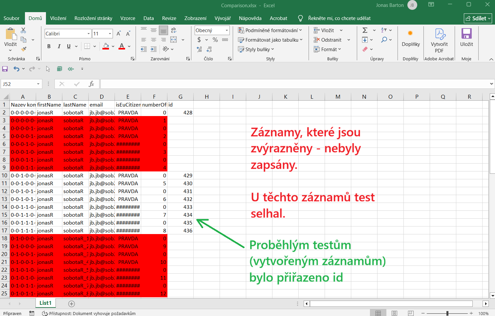

## Porovnání, které requesty proběhy a které neproběhly - výsledky

Soubor xlsx s výsledky je zde [Comparison.xlsx](https://github.com/jonasRower/Testing-Engeto-Project-2/blob/main/results_tests/POST_kombinace/Comparison/Comparison.xlsx).

Každý řádek tabulky odpovídá jednomu Requestu POST. Řádky (Requesty) označené červeně, jsou requesty neproběhlé. Z testu vyplývá, že jakákoliv kombinace duplicitního vstupu (hopdnoty) je možná - s vyjímkou duplicitní hodnoty atributu email.

Nelze tedy do DB přidat duplicitní email. Jakékoliv jiné kombinace vstupů jsou možné.

